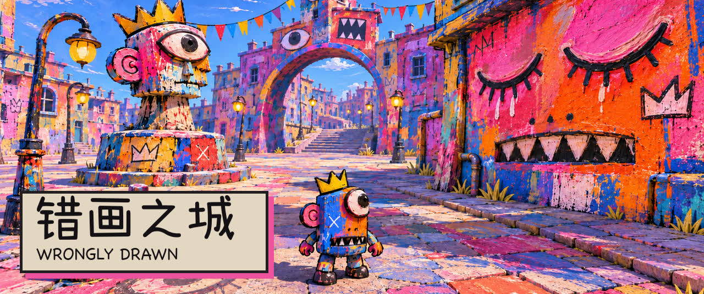
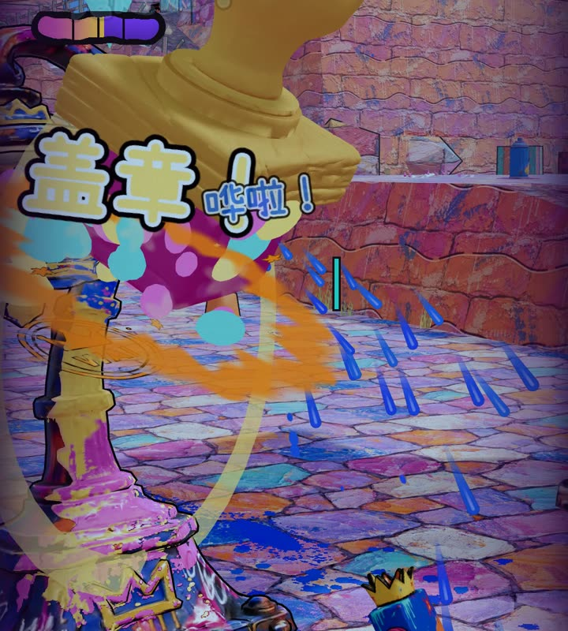
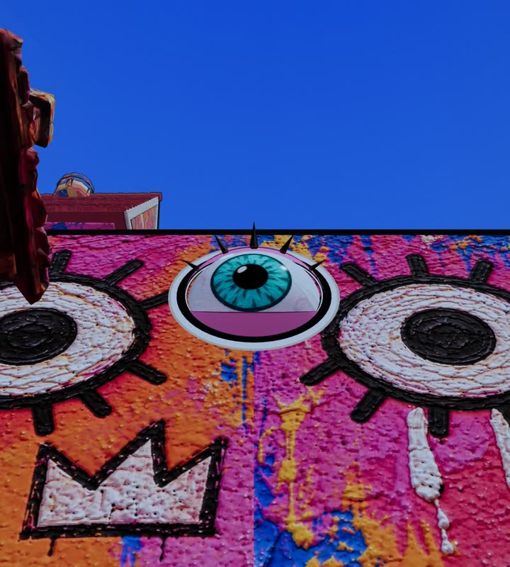
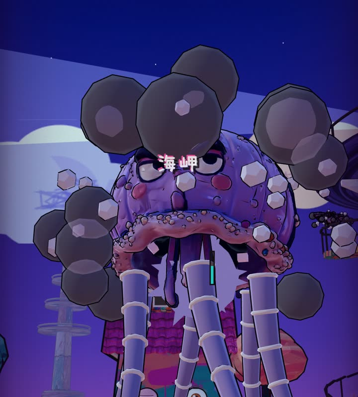
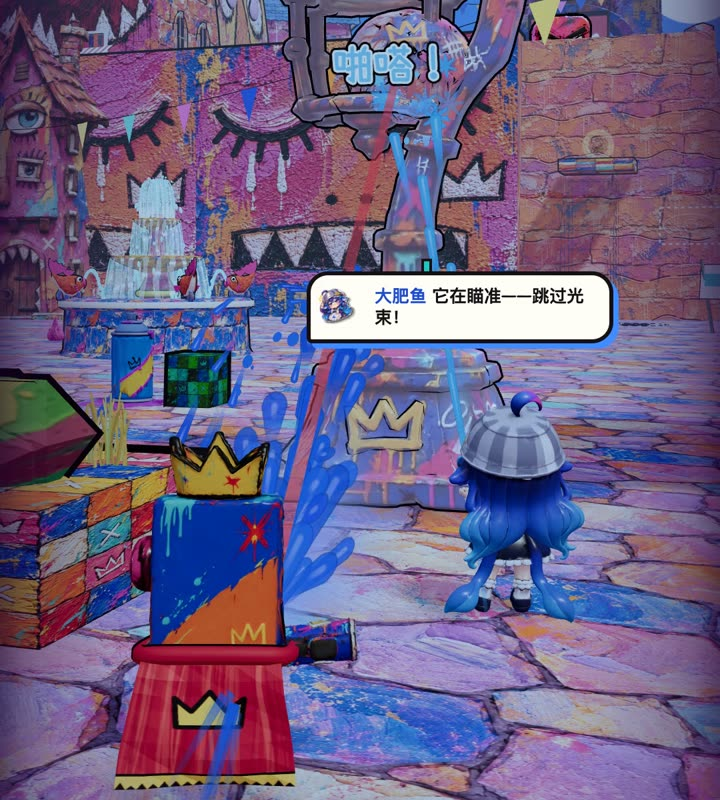
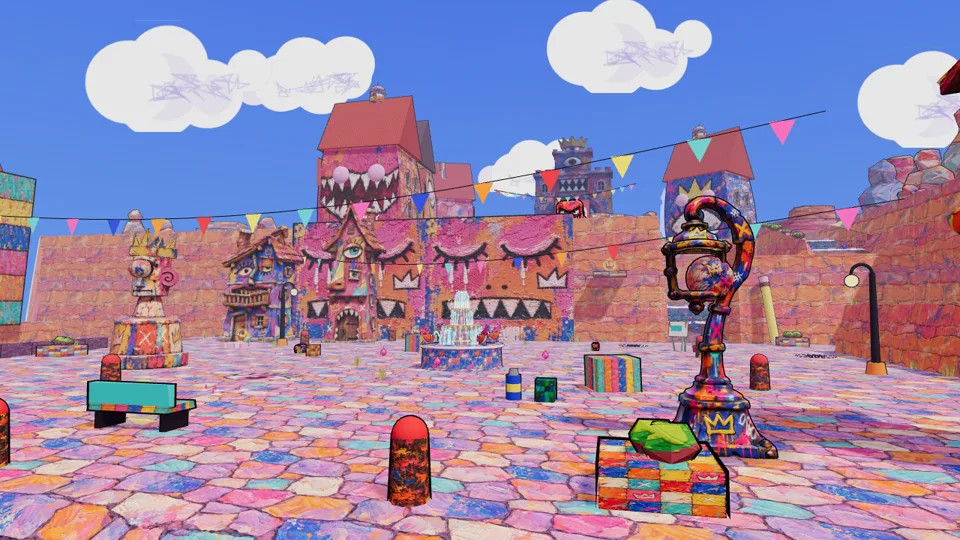
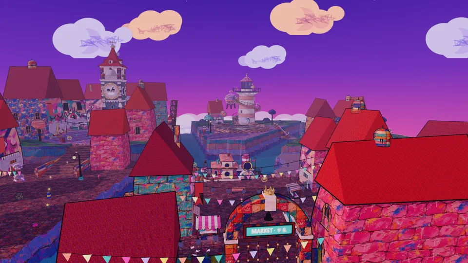
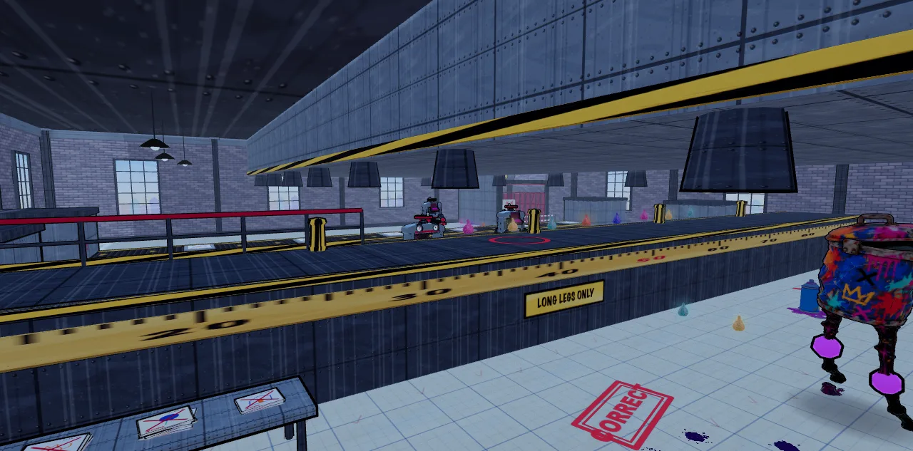

<p align="center">
  <a href="https://wrongdraw.maequeen.top/"></a>
</p>

<h1 align="center">错画之城 · Wrongly Drawn</h1>

<p align="center"><b>一座被红笔打满叉的城，在这儿，画歪了才算赢。</b><br>
<i>A city the Red Pen crossed out. Here, drawing it wrong is how you win.</i></p>

<p align="center">
  <a href="https://wrongdraw.maequeen.top/"></a>
  <a href="https://testflight.apple.com/join/hRrbcM4Q"></a>
  <a href="https://www.taptap.cn/app/1067620"></a>
  <a href="https://github.com/IDKhow2do/WronglyDrawn/releases/latest"></a>
</p>

<p align="center">
  
  
  
  
  
  <a href="LICENSE"></a>
  <a href="../../actions/workflows/checks.yml"></a>
</p>

浏览器里的第三人称 3D 动作解谜游戏，打开网页就能玩，不用安装。你是页边的小涂鸦 WAI，用喷漆把被“改正”的怪物重新涂回颜色，把眼睛、嘴巴、腿这些贴纸戴在自己身上，或者借给路灯、木箱、悬崖，让整座城醒过来。没有东西会被打死。

*A third-person 3D action-puzzle game that runs in the browser, nothing to install. You are WAI, a doodle from the margin. Repaint creatures instead of killing them; wear the Eye, Mouth and Legs stickers or lend them to the world. [English summary below](#english).*

<table>
  <tr>
    <td width="25%"></td>
    <td width="25%"></td>
    <td width="25%"></td>
    <td width="25%"></td>
  </tr>
  <tr>
    <td align="center">喷到发晃，盖章<br><sub>Spray, then stamp</sub></td>
    <td align="center">把眼睛借给悬崖<br><sub>Lend the Eye to a cliff</sub></td>
    <td align="center">吃声音的水母「嘘」<br><sub>Hush, who eats sound</sub></td>
    <td align="center">AI 队友大肥鱼<br><sub>The Fat Fish, your AI partner</sub></td>
  </tr>
</table>

<table>
  <tr>
    <td width="33%"></td>
    <td width="33%"></td>
    <td width="33%"></td>
  </tr>
  <tr>
    <td align="center">盲眼广场 · Blind Plaza</td>
    <td align="center">无声码头 · Mute Harbor</td>
    <td align="center">瘸腿工厂 · Limp Works</td>
  </tr>
</table>

## 游戏里有什么

- **三关，三场硬仗**：盲眼广场（橡皮擦）、无声码头（吃声音的水母「嘘」）、瘸腿工厂（红笔）。
- **喷漆不是枪**：颜料真的留在墙上和怪物身上。把怪物喷到发晃，冲上去盖章；有了黄金印章还能连盖，贪心盖歪就白干。
- **贴纸能戴也能借**：戴上眼睛是「真视」，没画完的铅笔草图会变成真的；把眼睛借给睡着的悬崖，它睁眼，路就被重新画出来；把腿借给木箱，它跟着你走，还能骑。
- **第二关多一招「喊」**：城市没了声音，你把它吼回来。
- **AI 队友大肥鱼**：打不过就在暂停菜单里把她叫出来。她自带一个不联网的小脑子；填上你自己的 DeepSeek 密钥，她还能聊天、听指挥。密钥只存在你自己的浏览器里。
- **装备和增益**：四种喷嘴、四种道具、八个护符；每救醒一位守护者，三张增益挑一张。
- **四种画风**（涂鸦、日晒漫画、绘本、孔版印刷），还能自己调色。
- 电脑和手机浏览器都能玩，触屏有单独的一套按键。

## 操作

| | 电脑 | 手机 / 平板 |
|---|---|---|
| 移动 | WASD（Shift 跑） | 左手摇杆（推到边缘是跑） |
| 视角 | 鼠标（点一下锁定）· 触控板双指 · 方向键 | 右手拖动 |
| 喷漆 | 按住鼠标左键 | 喷漆键 |
| 瞄准（第一人称） | 按住鼠标右键或 Z | 瞄准键 |
| 跳 / 翻滚 | 空格 / C | 跳 / 翻滚键 |
| 选眼睛 / 嘴巴 / 腿 | Q / R / F（长按：净化或收回） | 对应贴纸键 |
| 互动、盖章、把贴纸借出去 | E | 互动键 |
| 举起和扔 | G | 举起键 |
| 道具 | B | 道具键 |
| 喊（第二关起） | X（按住是怒吼） | 喊键 |
| 装备库 / 调色 | Tab / L | 暂停菜单里 |
| 和大肥鱼说话 | 回车 | 聊天键 |
| 暂停 | Esc | ❚❚ |

## 下载

- **安卓**：到 [Releases](https://github.com/IDKhow2do/WronglyDrawn/releases/latest) 下载 `WronglyDrawn-<版本>-android.apk`，点开安装。系统会让你允许“安装未知应用”。安卓 8.0 以上，游戏装在手机里，离线也能玩。以后的版本直接覆盖安装，进度保留。
- **iOS**：用 [TestFlight](https://testflight.apple.com/join/hRrbcM4Q) 加入测试。
- 不想装：[在浏览器里直接玩](https://wrongdraw.maequeen.top/)。

GitHub 在国内下载可能较慢。发版方法见 [docs/RELEASES.md](docs/RELEASES.md)。

## 网页版玩起来卡？

| 现象 | 怎么办 |
|---|---|
| 网络卡、加载很慢 | 开加速器再进。加载超过 8 秒，游戏也会提醒你。 |
| 画面卡、掉帧 | 先在暂停菜单把「画质」调到「低」。还卡就打开浏览器设置里的「硬件加速」（Chrome / Edge：设置 → 系统 → 使用图形加速），重启浏览器。笔记本记得插电。 |

游戏会自己降分辨率和画质。降到底还卡，它会弹一次提示。浏览器没在用显卡时（硬件加速关着），提示会直接说出来。

## 在自己电脑上跑

需要 Node.js 22 或更新。

```bash
npm ci
npm run dev
```

打开终端里显示的本地地址（默认 `http://localhost:5188`）。正式构建：

```bash
npm run build
```

产物在 `dist/`，是纯静态文件，放到任何静态托管上都能玩。

想让大肥鱼在本地开发时用服务器端的密钥，复制一份 `.env.local` 写上 `DEEPSEEK_API_KEY=你的密钥`（这个文件不会被提交）。不写也能玩，她用内置的规则脑。

## 代码在哪

| 目录 | 内容 |
|---|---|
| `src/` | 游戏本体（TypeScript）。`level/` 关卡，`enemy/` 怪物和 Boss，`player/`、`weapon/`、`combat/` 主角和战斗，`render/` 渲染，`coop/` 大肥鱼，`ui/` 界面，`i18n/` 中英文案 |
| `public/` | 模型、贴图、音乐、音效、字体 |
| `server/` | 开发服务器里给大肥鱼用的接口 |
| `docs/` | 设计文档、素材清单、性能和难度的测试记录 |
| `video/`、`trailer/` | 介绍视频和预告片的制作工程 |
| `landing/` | 网站的落地页（纯静态） |
| `android/` | 安卓应用：一层 WebView 外壳，把网页版打包进 APK |
| `.github/` | Issue 模板、网站的自动发布（[docs/DEPLOY.md](docs/DEPLOY.md)）和下载版的发布（[docs/RELEASES.md](docs/RELEASES.md)） |

每个目录的 `CLAUDE.md` 和文件头注释说明它负责什么、依赖谁。

## 反馈和参与

- 遇到 Bug 或者有想法，请开一个 [Issue](../../issues/new/choose)，有模板。
- 想改代码，先看 [CONTRIBUTING.md](CONTRIBUTING.md)。

## 许可

- 巴特歪的项目代码采用 [PolyForm Noncommercial 1.0.0](LICENSE)。欢迎非商用运行、修改和分享。署名和许可范围见 [NOTICE](NOTICE)。
- 游戏自己的美术、模型、故事和名字：保留权利，可以用来构建、游玩、学习和做介绍视频，不可以拆出来另作他用，见 [LICENSE-ASSETS.md](LICENSE-ASSETS.md)。
- 音乐和音效是 CC0，字体是 OFL。完整来源见 [CREDITS.md](CREDITS.md)。

这个游戏的大部分代码和素材是和 AI 一起做的：代码用 Claude Code 和 Codex，三视图用 Codex 的图像生成，模型用 Tripo。

## English

Wrongly Drawn is a browser game built with TypeScript, three.js and Rapier. Three levels, each ending in a boss; a spray can that repaints creatures instead of killing them; Eye, Mouth and Legs stickers that you wear as abilities or lend to objects in the world; an optional AI partner (the Fat Fish) who plays offline with a built-in rule brain and can chat if you enter your own DeepSeek key, which stays in your browser.

**[Play in the browser](https://wrongdraw.maequeen.top/).** If loading is slow, a network accelerator helps; if frames are choppy, set Graphics to Low in the pause menu and turn on hardware acceleration in your browser. Android players can download a signed APK (Android 8.0+, plays offline) from [Releases](https://github.com/IDKhow2do/WronglyDrawn/releases/latest); iOS is on [TestFlight](https://testflight.apple.com/join/hRrbcM4Q). To run it locally: `npm install`, then `npm run dev` (Node.js 22+). `npm run build` writes a static site to `dist/`.

The project code by 巴特歪 uses [PolyForm Noncommercial 1.0.0](LICENSE). Noncommercial use, modifications, and redistribution are welcome under its terms. See [NOTICE](NOTICE) for the license scope. The game's own art, models, story and name are all rights reserved with permission to build, play, study and show the game; see [LICENSE-ASSETS.md](LICENSE-ASSETS.md). Music and sound effects are CC0, the font is OFL; see [CREDITS.md](CREDITS.md). Bug reports and ideas are welcome in the issue tracker.
